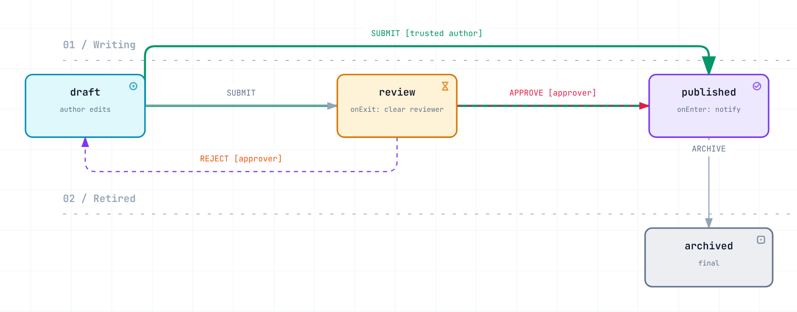

# state-machine

A small, strictly typed finite state machine for PHP 8.5. A modern rewrite of
[mouadziani/xstate](https://github.com/mouadziani/xstate).

```php
namespace App;

enum VideoState: string
{
    case Stopped = 'stopped';
    case Playing = 'playing';
    case Paused = 'paused';
}

enum VideoEvent: string
{
    case Play = 'PLAY';
    case Pause = 'PAUSE';
    case Stop = 'STOP';
}
```

```php
use App\{VideoEvent as E, VideoState as S};
use Dudas\StateMachine\{Definition, Machine, Transition, TransitionContext};

$definition = Definition::builder()
    ->initial(S::Stopped)
    ->states(...S::cases())
    ->transition(
        Transition::on(E::Play, from: [S::Stopped, S::Paused], to: S::Playing)
            ->withGuard(fn (TransitionContext $c) => $c->payload['licensed'] ?? false)
            ->withAfter(fn (TransitionContext $c) => $log->info("{$c->from} -> {$c->to}")),
        Transition::on(E::Pause, S::Playing, S::Paused),
        Transition::on(E::Stop, S::Playing, S::Stopped),
    )
    ->build();

$video = new Machine($definition);
$video->send(E::Play, ['licensed' => true]);
$video->is(S::Playing);          // true
$video->stateAs(S::class);       // S::Playing ($video->state is the name: 'playing')
$video->availableEvents();       // ['PAUSE', 'STOP']
$video->can(E::Play);            // false
```

Enums are the recommended way to name states and events: every method takes them, and only string-backed enums
are accepted. Plain strings work too (they are what the store holds). There is no `->value` to write:
`stateAs()` returns the enum, `InMemoryStore` takes one, and `machine()` takes `[state, hook]` pairs where PHP
array keys could not hold an enum.

## Shorthand helpers

```php
use function Dudas\StateMachine\{machine, on};

$doc = machine(
    initial: S::Draft,
    states: S::class,                                  // an enum class lists all its cases
    transitions: [
        on(E::Submit, S::Draft, S::Review),
        on(E::Approve, S::Review, S::Published, guard: new ApproverGuard(), after: $audit),
    ],
    onEnter: [[S::Published, $notify]],                // [state, hook(s)] pairs; a name-keyed map works too
);

$doc->sendIfAllowed(E::Approve, $payload);             // bool, never throws for a refusal
$result = $doc->tryTransition(E::Approve, $payload);   // ->ok(), ->failure (why), ->state
```

`Definition::fromTable($initial, [[E::Submit, S::Draft, S::Review], ...])` builds a guard-less definition
from plain rows. `sendIfAllowed`/`tryTransition` only absorb refusals (unknown event, not allowed, guard veto);
hook and concurrency failures still throw.

### More sugar

```php
use function Dudas\StateMachine\{allOf, not, payloadIs, payloadsEqual, machineFor};

// guards as values: no one-off class for simple rules
on(E::Approve, S::Review, S::Published,
    guard: allOf(payloadIs('role', 'approver'), not(payloadsEqual('actor', 'author'))));

$flow = machineFor($definition, $document);       // state lives in $document->status (string or enum typed)
$flow->sendAll([E::Submit, [E::Approve, $payload]]);

$definition->toMermaid();                         // stateDiagram-v2 text; toDot() for Graphviz
$definition->unreachableStates();                 // lint: states nothing can reach
machine(..., history: true)->history();           // opt-in log of applied transitions (history: 50 keeps the last 50)
```

`anyOf()` is the OR counterpart of `allOf()`. `history: true` grows without bound, so history is off by default.

### Generators

```php
foreach ($machine->stream($queueConsumer) as $result) {   // lazy: one TransitionResult per event, refusals don't stop it
    if (!$result->ok()) { $log->warning($result->failure->getMessage()); }
}

$machine->drive((function () {                            // a process that branches on each outcome
    $review = yield E::Submit;
    if ($review->ok()) {
        yield [E::Approve, ['role' => 'approver']];
    }
})());

foreach ($definition->shortestPaths() as $state => $events) { /* events that reach $state, e.g. for tests */ }
```

### Why not? Blockers and metadata

Ask *why* an event is refused, not just whether (like Symfony Workflow's transition blockers), and keep labels,
roles and messages next to the transitions they describe (like `meta` in XState):

```php
use function Dudas\StateMachine\{because, allOf, payloadIs, on};

on(E::Approve, S::Review, S::Published,
    guard: allOf(
        because(payloadIs('role', 'approver'), 'Only approvers can approve.', code: 'not_approver'),
        because(fn ($c) => $c->payload['signed'] ?? false, 'The document is not signed yet.', code: 'unsigned'),
    ),
    meta: ['label' => 'Approve', 'style' => 'primary', 'blocked' => 'This document cannot be approved yet.'],
);

$doc->blockers(E::Approve, $payload);           // list<Blocker>: code, message, parameters; [] when allowed
$doc->tryTransition(E::Approve)->blockers();    // the same reasons for a refused attempt
$e->blockers();                                 // on the GuardRejectedException a send() throws

foreach ($doc->availableTransitions($payload) as $t) {   // the transitions, for their meta
    echo $button($t->meta['label'] ?? $t->event, $t->meta['style'] ?? 'default');
}
```

- `allOf()` lists **every** failing guard, not only the first; `anyOf()` explains only when every alternative fails.
- A guard class can explain itself by implementing `ExplainingGuard::blockers()` (see `examples/Document/ApproverGuard.php`).
- A guard that gives no reason yields a `Blocker::GUARD_REJECTED`; the transition's `meta['blocked']` supplies its
  message, so the wording lives in the definition rather than in the guard.
- Unknown and not-allowed events are explained too (`Blocker::UNKNOWN_EVENT`, `Blocker::NOT_ALLOWED`).
- Guards and hooks see the transition's metadata as `$context->meta`. States have metadata as well:
  `->meta(S::Review, ['label' => 'In review'])` on the builder, `$definition->metaFor(S::Review)`.
- `toMermaid()`/`toDot()` show `label`s.

`blockers()` asks every guard of every candidate transition, so it costs more than `can()`; a refused `send()` or
`tryTransition()` asks them once more to fill the exception's blockers. `sendIfAllowed()` and successful sends never do.

## Design

- `Definition` is an immutable, validated blueprint (shareable); `Machine` is the runtime instance.
- State lives in a `StateStore` (`InMemoryStore` by default, `CallbackStore`/`PropertyStore` to drive a property of an
  entity, `AtomicCallbackStore` for a compare-and-set on a shared row, `LockingStore` to decide under a lock).
- States and events may be strings or backed enums.
- Guards (`Guard`) and hooks (`Hook`) are interfaces; closures are wrapped automatically.
- Several transitions may share event + source state; the first whose guards pass wins.
- Exceptions all implement `StateMachineException`; an invalid event/state (`TransitionNotAllowedException`)
  is distinct from a guard veto (`GuardRejectedException`, a subclass).

## Examples

Diagrams are in [`preview/`](preview/); open the `.html` files for an interactive view (search, focus, trace, export).

**`examples/Document`**: approval workflow over an entity holding a status enum via `CallbackStore`, a named
`ApproverGuard` that explains its refusals, enter/exit hooks, button labels in transition metadata.

<picture>
  <source media="(prefers-color-scheme: dark)" srcset="preview/document.dark.png">
  
</picture>

**`examples/Payment`**: conditional branching on a gateway answer, an amount guard, an enter hook, an atomic store.

<picture>
  <source media="(prefers-color-scheme: dark)" srcset="preview/payment.dark.png">
  
</picture>

**`examples/OrderStatus`**: a 31-status matrix checked against legacy rules, shown here by status group.

<picture>
  <source media="(prefers-color-scheme: dark)" srcset="preview/order-status.dark.png">
  
</picture>

## Semantics

`send()` runs: select transition (guards) → `before` hooks → `onExit` hooks → store write → `onEnter` hooks → `after` hooks.
`onEnter`/`onExit` are per-state hooks registered on the builder (`->onEnter(S::Playing, fn ($c) => ...)`).

| Situation | Result |
|---|---|
| Unknown event | `UnknownEventException` |
| No transition from the current state | `TransitionNotAllowedException` |
| Transition exists but every guard vetoes | `GuardRejectedException` (`->blockers()` says why) |
| `before` or `onExit` hook throws | transition aborted, state unchanged, the transition's `abort` hooks run, exception propagates |
| `send()` from a `before`/`onExit` hook | `ConcurrentTransitionException`, stale transition not applied |
| State changed during `before`/`onExit` hooks, or the atomic write lost the race | `ConcurrentTransitionException`, `abort` hooks run |
| `send()` from a guard (also inside `can()`) | `ConcurrentTransitionException` |
| `send()` from another fiber while a transition is running | `ConcurrentTransitionException` (reads stay possible) |
| `send()`/`tryTransition()` from an `onEnter`/`after` hook | queued; applied after every hook of the current transition, inside the outer call |
| A queued `send()` is refused | its exception propagates from the outer call; the outer transition stays applied |
| A queued `tryTransition()`/`sendIfAllowed()` is refused | dropped; the hook got a result with `->queued === true` |
| Hooks keep chaining events (a cycle) | `ChainLimitExceededException` after `maxChainedEvents` (default 100) |
| `onEnter`/`after` hook throws `Exception` | state already changed, **not** rolled back; the remaining hooks still run; `AfterHookFailedException` (first in `getPrevious()`, all in `->failures`, context in `->context`); events they queued are dropped |
| `onEnter`/`after` hook throws an `Error` | propagates unwrapped (a bug); the state has already changed |
| Store holds an unknown or missing state | `UnknownStateException` |
| `PropertyStore` property is readonly or its enum lacks a state | `InvalidDefinitionException` when the machine is built |

`TransitionResult` carries `state` (the state this transition entered, or the unchanged state), `failure`,
`context` (the applied `TransitionContext`) and `queued`. `sendAll()` is not atomic: earlier events stay applied
when a later one fails (use `stream()` to see each outcome).

### Concurrency

- Check-then-act is racy: prefer `tryTransition()`/`sendIfAllowed()` to `if ($m->can($e)) { $m->send($e); }`.
- **One process, one row:** `InMemoryStore`, `CallbackStore`, `PropertyStore` (`machineFor()`) are fine.
- **Several processes, one row:** make the write conditional. `AtomicStateStore::compareAndSet($expected, $new)`
  (`AtomicCallbackStore`, or `machineFor(..., compareAndSet: fn ($expected, $new) => $repo->update(...) === 1)`).
  The loser gets `ConcurrentTransitionException`; retry by sending again (it re-reads the state and re-plans).
  If the reader lags behind the write (an entity property nobody updated), `AtomicCallbackStore` reports the state it
  wrote; pass `afterWrite:` to keep the entity in step.
- **Guards that read more than the state** (a balance, a stock level): a compare-and-set on the status cannot notice
  those changing. Wrap the store in a `LockingStore` (any `TransactionalStateStore`): selection, guards, `before`/`onExit`
  hooks and the write run inside your transaction (`SELECT ... FOR UPDATE`), `onEnter`/`after` hooks after it returns.
- **Side effects of `before`/`onExit` hooks** cannot be rolled back by the library: undo them in `abort` hooks
  (`->withAbort()`, `on(..., abort: ...)`), or do them in `onEnter`/`after` hooks (or an outbox) instead.
- **Fibers** (Revolt/Amp, Swoole, FrankenPHP): a machine instance applies one transition at a time; a send from another
  fiber meanwhile is refused instead of interleaving. Use one machine per request/fiber, and an atomic store for shared rows.
- **Long-running workers:** a `Definition` and its guard/hook objects are shared by every machine; keep them stateless.

States and events must be strings or **string-backed** enums; int-backed enums are rejected.
Guards may run twice (`can()` then `send()`), so keep them side-effect free.

## Performance and memory

`php bench/run.php` measures the hot paths; CI runs it for every pull request next to the base branch on the
same runner. On a CI runner (PHP 8.5): `send()` ≈ 0.6 µs, `can()` ≈ 0.2 µs, `availableEvents()` ≈ 1.5 µs for a
state in a 350-transition graph (only transitions leaving the current state are looked at).

- Nothing accumulates per send: `tests/MemoryTest.php` repeats every path (success, refusal, hook failures,
  chained events, fibers, atomic/locking stores) thousands of times and fails if memory grows.
- `history: true` keeps every transition (it grows by design); use `history: N` in long-running workers.
- A refusal costs an exception only when one is shown: `sendIfAllowed()` builds none, `tryTransition()` returns
  one, `send()` throws one. Exception traces keep the payload alive while you hold a `TransitionResult`,
  unless `zend.exception_ignore_args=On` (the production default).
- Keep guards cheap: `can()`, `availableEvents()` and every send evaluate them.

## Differences from xstate (mouadziani)

- Guards receive a `TransitionContext` (event, from, to, payload) instead of `($from, $to)`.
- `before`/`after` hooks work (the original `after()` overwrote `before`); `before` can abort.
- No `__call` magic (`$video->play()`): not statically analysable. Use `send()` with an enum.
- Definition is validated up front: undeclared states and missing initial state fail fast.

## PHP 8.5 features used (for the later downgrade)

`clone($obj, [...])` with-ers on readonly classes, `#[\NoDiscard]`, property hooks and an
interface property (`public string $state { get; }`), `array_find`/`array_any`/`array_all`,
`readonly` classes, first-class callable syntax.

## PHP 7.2

This is the `2.x` line of `nandordudas/state-machine`. A hand-port without enums for PHP 7.2 to 8.4 lives on branch
`php72` and is the `1.x` line of the same package; `composer require nandordudas/state-machine` picks the newest
line your PHP supports (pin `^1.0` to stay on the string-based API).

## Develop

```
composer install && composer check   # phpstan (max) + phpunit
mago fmt --check && mago lint && mago analyze   # Mago: config in mago.toml
```

## Editor and agent setup

- `.vscode/`: recommended extensions (Intelephense, Mago, PHPStan, PHPUnit test explorer, Xdebug, EditorConfig, TOML),
  format-on-save with Mago, and tasks for `composer check` and the Mago commands. `.editorconfig` sets 4-space PHP.
- `AGENTS.md` (and `CLAUDE.md` importing it): conventions and API cheat sheet for AI coding agents.
- `.claude/skills/state-machine/`: a Claude skill that teaches modelling workflows with this library.

## CI

`.github/workflows/ci.yml` builds and verifies both packages (`main` on PHP 8.5, `php72` on PHP 7.2) with Mago,
PHPStan and PHPUnit, and uploads each package as a `composer archive` zip artifact.
