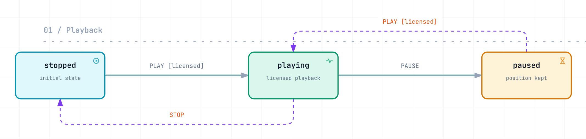
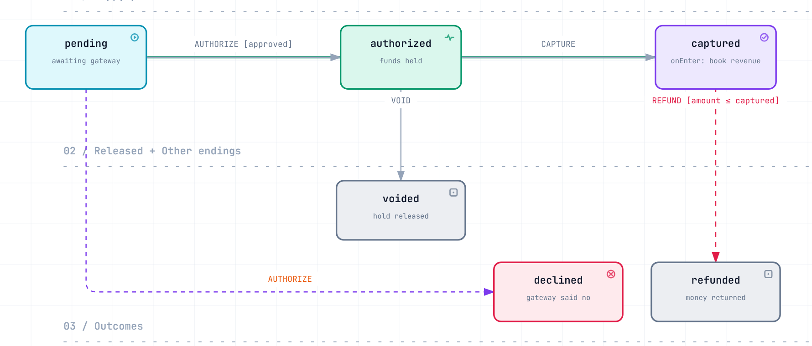
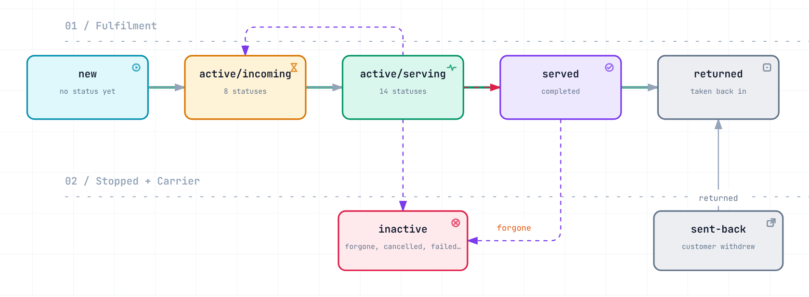

# state-machine

A small, strictly typed finite state machine for PHP 8.5: a `Definition` (states, transitions, guards, hooks) run by a
`Machine` whose state lives in a store you choose (memory, an entity property, a database row).

```bash
composer require nandordudas/state-machine
```

## Quick start

```php
namespace App;

enum VideoState: string
{
    case Stopped = 'stopped';
    case Playing = 'playing';
    case Paused = 'paused';
}

enum VideoEvent: string
{
    case Play = 'PLAY';
    case Pause = 'PAUSE';
    case Stop = 'STOP';
}
```

```php
use App\{VideoEvent as E, VideoState as S};
use Dudas\StateMachine\{Definition, Machine, Transition, TransitionContext};

$definition = Definition::builder()
    ->initial(S::Stopped)
    ->states(...S::cases())
    ->transition(
        Transition::on(E::Play, from: [S::Stopped, S::Paused], to: S::Playing)
            ->withGuard(fn (TransitionContext $c) => $c->payload['licensed'] ?? false)
            ->withAfter(fn (TransitionContext $c) => $log->info("{$c->from} -> {$c->to}")),
        Transition::on(E::Pause, S::Playing, S::Paused),
        Transition::on(E::Stop, S::Playing, S::Stopped),
    )
    ->build();

$video = new Machine($definition);
$video->send(E::Play, ['licensed' => true]);   // throws when the event is refused
$video->is(S::Playing);                        // true
$video->stateAs(S::class);                     // S::Playing ($video->state is the name: 'playing')
$video->availableEvents();                     // ['PAUSE', 'STOP']
$video->can(E::Play);                          // false
$video->tryTransition(E::Play)->ok();          // false: a refusal as a result instead of an exception
```

<picture>
  <source media="(prefers-color-scheme: dark)" srcset="docs/diagrams/video.dark.png">
  
</picture>

Name states and events with string-backed enums; every method takes them and no `->value` is needed. Plain strings
work too (they are what a store holds).

## Shorthand

```php
use function Dudas\StateMachine\{machine, on, allOf, not, payloadIs, payloadsEqual, machineFor};

$doc = machine(
    initial: S::Draft,
    states: S::class,                                  // an enum class lists all its cases
    transitions: [
        on(E::Submit, S::Draft, S::Review),
        on(E::Approve, S::Review, S::Published,
            guard: allOf(payloadIs('role', 'approver'), not(payloadsEqual('actor', 'author')))),
    ],
    onEnter: [[S::Published, $notify]],                // [state, hook(s)] pairs
);

$result = $doc->tryTransition(E::Approve, $payload);   // ->ok(), ->failure (why), ->state
$doc->sendAll([E::Submit, [E::Approve, $payload]]);    // in order; stops at the first failure

$flow = machineFor($definition, $document);            // state lives in $document->status (string or enum typed)
```

`Definition::fromTable(S::Draft, [[E::Submit, S::Draft, S::Review], ...])` builds a guard-less definition from rows.
Several transitions may share an event and a source state: the first whose guards pass wins.

## Why was it refused?

```php
use function Dudas\StateMachine\because;

on(E::Approve, S::Review, S::Published, guard: allOf(
    because(payloadIs('role', 'approver'), 'Only approvers can approve.', code: 'not_approver'),
    because(fn ($c) => $c->payload['signed'] ?? false, 'The document is not signed yet.', code: 'unsigned'),
));

$doc->blockers(E::Approve, $payload);       // list<Blocker> (code, message, parameters); [] when allowed
$doc->tryTransition(E::Approve)->blockers(); // the same reasons for a refused attempt; also GuardRejectedException::blockers()
```

`allOf()` lists every failing guard, `anyOf()` explains only when all alternatives fail. A guard class can explain
itself by implementing `ExplainingGuard` (see `examples/Document/ApproverGuard.php`); a guard that gives no reason is
reported as `Blocker::GUARD_REJECTED`. Transitions can carry `meta` (`on(..., meta: ['label' => 'Approve'])`,
`->withMeta()`), visible to guards and hooks as `$context->meta` and shown as labels in diagrams.

## Semantics

`send()` runs: select transition (guards) → `before` hooks → `onExit` hooks → store write → `onEnter` hooks →
`after` hooks. `onEnter`/`onExit` are per-state hooks (`->onEnter(S::Playing, fn ($c) => ...)` on the builder).

| Situation | Result |
|---|---|
| Unknown event | `UnknownEventException` |
| No transition from the current state | `TransitionNotAllowedException` |
| Every matching guard vetoes | `GuardRejectedException` (a subclass of the above; `->blockers()` says why) |
| `before` or `onExit` hook throws | transition aborted, state unchanged, exception propagates |
| State changed meanwhile, or the atomic write lost the race | `ConcurrentTransitionException` (`->retryable`) |
| `send()` from a guard or a `before`/`onExit` hook, or from another fiber mid-transition | `ConcurrentTransitionException` |
| `send()`/`tryTransition()` from an `onEnter`/`after` hook | queued; applied after the current transition's hooks, inside the outer call |
| A queued `send()` is refused | its exception propagates from the outer call; the outer transition stays applied |
| Hooks keep chaining events | `ChainLimitExceededException` after `maxChainedEvents` (default 100, a `Machine` argument) |
| `onEnter`/`after` hook throws `Exception` | state already changed, **not** rolled back; the other hooks still run; `AfterHookFailedException` (`->failures`) |
| A self-loop (`from === to`) | hooks run, nothing is written |
| Store holds an unknown or missing state | `UnknownStateException` |

Guards must be side-effect free: `can()`, `availableEvents()` and `blockers()` evaluate them too. `sendAll()` is not
atomic: events applied before a failing one stay applied.

## Concurrency

- **Check-then-act is racy:** prefer `tryTransition()` to `if ($m->can($e)) { $m->send($e); }`.
- **One process owns the row:** `InMemoryStore`, `CallbackStore` and `PropertyStore` (`machineFor()`) are fine. They
  read then write, so they cannot see another process.
- **Several processes, one row:** make the write conditional with an `AtomicStateStore`: `AtomicCallbackStore`, or
  `machineFor(..., compareAndSet: fn ($expected, $new) => $repo->update(...) === 1)`. The loser gets
  `ConcurrentTransitionException` with `->retryable === true`. **Reload the entity before retrying**, otherwise the
  retry reads the old value and loses again; pass `afterWrite:` to keep the entity in step with your own writes.
- **Guards that read more than the state** (a balance, stock): wrap the store in a `LockingStore`. Guards, `before`/`onExit`
  hooks and the write then run inside your transaction (`SELECT ... FOR UPDATE`), `onEnter`/`after` hooks after
  commit. A failed transaction does not roll the entity back: refresh or discard it after a failure.
- **What to retry:** `ConcurrentTransitionException` with `->retryable` was not applied, so reload and retry.
  `TransitionApplied` exceptions (`AfterHookFailedException`, `ChainLimitExceededException`) were applied: do
  **not** retry. Refusals were not applied; de-duplicate replayed webhooks by event id if you must tell them apart.
- **Fibers, workers:** use one machine per request or fiber (Swoole coroutines are not detected), and keep guard and
  hook objects stateless: a `Definition` is shared by every machine built from it.

`tests/Integration` checks these claims against SQLite and, in CI, MySQL (`DB_DSN`, `DB_USER`, `DB_PASS`).

## Diagnostics

```php
$definition->toMermaid();               // stateDiagram-v2 text; toDot() for Graphviz
$definition->unreachableStates();       // states nothing can reach
new Machine($definition, recordHistory: 50)->history();   // the latest 50 transitions (true keeps all)
```

## Examples

**`examples/Document`**: an approval workflow over an entity holding a status enum, an `ApproverGuard` that explains
its refusals, enter/exit hooks.

<picture>
  <source media="(prefers-color-scheme: dark)" srcset="docs/diagrams/document.dark.png">
  
</picture>

**`examples/Payment`**: branching on a gateway answer, an amount guard, an enter hook, an atomic store.

<picture>
  <source media="(prefers-color-scheme: dark)" srcset="docs/diagrams/payment.dark.png">
  
</picture>

**`examples/OrderStatus`**: a 31-status matrix checked against legacy rules, shown here by status group.

<picture>
  <source media="(prefers-color-scheme: dark)" srcset="docs/diagrams/order-status.dark.png">
  
</picture>

The diagrams and their sources are in [`docs/diagrams`](docs/diagrams/).

## Compatibility promise

Public (semver applies; behaviour counts too: hook order, exception types, concurrency semantics): `Machine`,
`Definition`, `DefinitionBuilder`, `Transition`, `TransitionContext`, `TransitionResult`, `Blocker`, the `Contracts`
interfaces, the stores, the guards, the exceptions and the helper functions (`machine`, `on`, `machineFor`, `allOf`, ...).
Everything marked `@internal` (`Refusal`, `Name`, `Diagram`, the `*Entries`/`listOf` helpers) may change in any
release. Depend on `^3.0`. See `CHANGELOG.md`; security reports go through `SECURITY.md`.

## Develop

```
composer install && composer check              # phpstan (max) + phpunit
mago fmt --check && mago lint && mago analyze   # config in mago.toml
php bench/run.php                               # hot paths; CI compares a pull request with its base
```

`AGENTS.md` (imported by `CLAUDE.md`) has the conventions for AI coding agents, and `.claude/skills/state-machine/`
teaches modelling workflows with this library. `.vscode/` has the recommended extensions and tasks.
